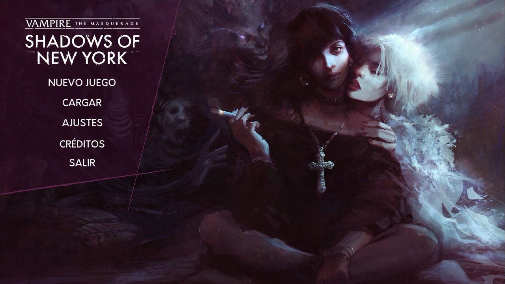
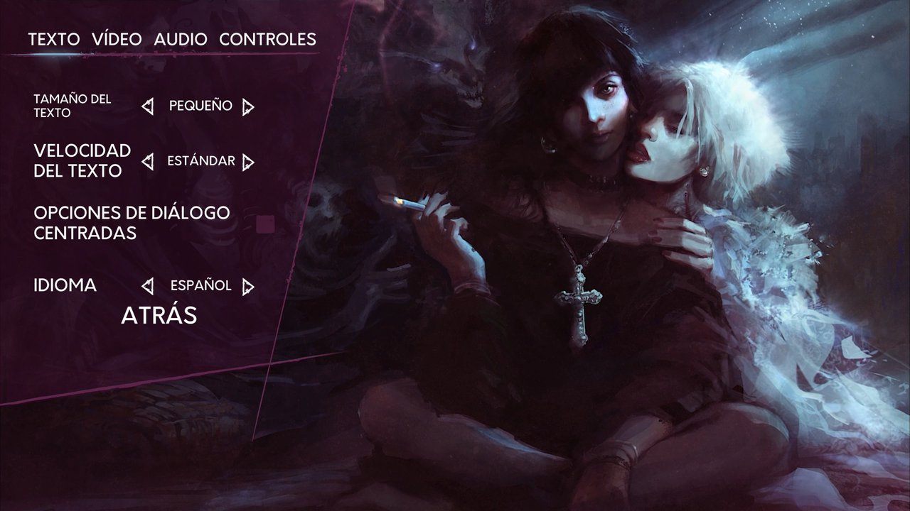

# Vampire: The Masquerade — Shadows of New York, en español

Traducción no oficial al español de España de *Shadows of New York*, en forma de plugin
de BepInEx. El juego trae inglés, francés, portugués de Brasil y ruso; esto añade
**Español** como quinta opción en el selector de idiomas e inyecta el texto traducido al
arrancar. **No se modifica ningún archivo del juego.**

**Completa: 5699 de 5699 líneas de diálogo**, más el diccionario del juego, los nombres de
los personajes y las misiones. Todas las conversaciones, los dos finales y todas las ramas
opcionales.

| | |
|---|---|
|  |  |
| El menú principal, en español. | *Español* en **Ajustes → Texto → Idioma**, junto a los cuatro idiomas que trae el juego. |

> ### Hecha con IA: puede tener errores
>
> Tanto el texto en español como el plugin en C# los ha escrito un asistente de IA
> (Claude) bajo supervisión humana, pero **nadie se ha pasado todavía el juego entero en
> español para revisar el resultado.** Tómala como un primer borrador que funciona, no
> como una localización terminada.
>
> En la práctica, eso significa:
>
> - **La terminología debería ser fiable.** Los términos del glosario no se han inventado:
>   salen del español oficial que el propio juego trae escondido y, donde este no llega,
>   del de *Bloodlines 2*. Se comprueban automáticamente en cada compilación, y una forma
>   que se aparte de la oficial se rechaza antes de llegar al juego.
> - **Los errores estarán en el tono, el registro y el contexto.** Una comprobación
>   automática sabe que `[27;Vástago]` es correcto; no sabe si una frase sarcástica suena
>   sincera, ni si un personaje trata a Julia de *tú* en una escena y de *usted* en la
>   siguiente.
> - **Algún texto puede salirse del cuadro.** Las líneas se comprueban contra un límite
>   de longitud, pero ese límite es una estimación, no el motor del juego.
>
> [Abre una incidencia](../../issues) con cualquier cosa que suene mal. Un error que nadie
> comunica se queda en la traducción.

## Compatibilidad

**Solo PC con Windows.** Es la única configuración en la que se ha instalado y probado.

El juego existe también para Nintendo Switch, PS4 y Xbox One. **Ahí el mod no puede
funcionar de ninguna manera**: es un plugin de BepInEx, y BepInEx tiene que inyectarse en
el proceso antes de que arranque el juego, algo que una consola no permite. No hay
alternativa.

Steam y GOG venden también versiones para macOS y Linux. BepInEx soporta ambos sistemas y
nada en el plugin es específico de Windows, así que podría funcionar, pero **nadie lo ha
probado**, y los pasos de instalación de abajo están escritos para Windows. Lo mismo con
la versión de GOG para Windows: en principio es el mismo juego, pero las pruebas se han
hecho con la de Steam. Si consigues que funcione en otro sitio,
[dilo en una incidencia](../../issues) y esta sección dejará de ser tan prudente.

## Instalación

**[⬇ Descarga la última versión](../../releases/latest)**: un solo zip; para jugar no
hace falta nada más de este repositorio.

Todo lo que sigue se hace en la **carpeta del juego**, la que contiene
`VtM Shadows of New York.exe`. En una instalación de Steam por defecto es

```
C:\Program Files (x86)\Steam\steamapps\common\Vampire The Masquerade - Shadows of New York
```

Si tu biblioteca de Steam está en otro sitio, deja que Steam te la abra: botón derecho
sobre el juego en la biblioteca → **Administrar** → **Ver archivos locales**.

1. Instala [BepInEx 5.4.x (x64)](https://github.com/BepInEx/BepInEx/releases) en la
   carpeta del juego (el archivo se llama `BepInEx_win_x64_5.4.*.zip`; tiene que ser
   **x64**, no x86) y abre el juego una vez para que cree sus carpetas.
   [Paso a paso, con soluciones a los problemas habituales](release/README.md#instalación).
2. Descomprime la versión descargada en la carpeta del juego, de forma que los archivos
   queden en `BepInEx/plugins/SoNY-ESP/`.
3. Abre el juego y elige **Español** en los ajustes.

Cualquier línea que el plugin no encuentre se queda en inglés, así que un `es.csv`
incompleto o desajustado empeora el resultado con elegancia en lugar de romper el juego.

## Desinstalación

**Primero vuelve a poner el juego en inglés desde los ajustes.** El idioma elegido se
guarda como una posición en la lista de idiomas, y el español se añade al final. Sin el
plugin, la lista tiene una entrada menos y el juego ajusta la posición guardada a la
última que queda, que es el ruso, no el inglés. No se estropea nada, pero un juego que de
repente habla ruso se parece mucho a una instalación rota. Volver a elegir inglés en los
ajustes lo arregla en cualquier momento.

Después:

- **Para quitar solo la traducción**: borra `BepInEx/plugins/SoNY-ESP/`. BepInEx se queda,
  junto con cualquier otro plugin.
- **Para quitar también BepInEx**: borra `winhttp.dll`, `doorstop_config.ini`,
  `.doorstop_version`, `changelog.txt` y la carpeta `BepInEx`.

No se modifica nunca ningún archivo del juego, así que no hay nada que restaurar. No
toques `UnityPlayer.dll` ni `WinPixEventRuntime.dll`: son del juego, no de BepInEx.

## Cómo funciona

`TranslationManager.Languages` construye a mano una lista de cuatro idiomas y deja fuera
`spanishLanguage`, un campo que ya existe en la clase, junto a un valor `Language.ES` y
un método `GetTextEs`. Un postfix de Harmony añade la entrada que falta; el juego compone
entonces él solo la etiqueta del idioma como `es` + `[Female]`, que es justo el nombre del
campo en el que el plugin escribe la traducción.

El juego, además, **ya traía español oficial escondido** en sus tablas de interfaz: menú,
nombres, rasgos, títulos del diccionario y la mitad de las misiones. El plugin lo usa tal
cual y solo rellena los huecos (`ui_es.csv`); los diálogos, en cambio, nunca se tradujeron.

Todo lo que ata el plugin a un idioma está en
[`plugin/LanguageInfo.cs`](plugin/LanguageInfo.cs). Para otro idioma basta con cambiar ese
archivo, recompilar y traducir los CSV; antes, comprueba que las fuentes del juego tienen
los caracteres necesarios (el latín extendido funciona; el chino y el japonés, no).

## Cómo colaborar

Hay tres formas de ayudar, de menos a más esfuerzo. Todas sirven.

### 1. Avisar de un error mientras juegas

[Abre una incidencia](../../issues/new/choose) y elige la plantilla que corresponda:

| Plantilla | Para qué |
|---|---|
| **Error de traducción** | Una frase mal traducida, poco natural, o con el tono o el tratamiento equivocado. |
| **Texto cortado o fuera del cuadro** | La frase no cabe o se sale del borde. Aquí la captura es imprescindible. |
| **El mod no funciona** | El español no aparece, el juego sigue en inglés o no arranca. |

Las plantillas te van guiando campo a campo. Lo único imprescindible es **copiar unas
palabras del texto en español tal como sale en pantalla**: con eso se encuentra la línea
exacta entre 5699. Si no tienes cuenta de GitHub, vale también un comentario en Nexus o en
la guía de Steam.

### 2. Revisar a fondo con la hoja de revisión

Si quieres repasar escenas enteras con el inglés delante, sin tocar código:

1. En `BepInEx/config/sony.esp.cfg`, pon `Enabled = true` en la sección `[1. Dump]`.
2. Abre el juego hasta el menú principal y ciérralo.
3. En `BepInEx/plugins/SoNY-ESP/` aparece `review_es.csv`, con el inglés y el español
   lado a lado. Ábrelo con Excel, LibreOffice o Google Sheets y corrige la columna ES.
   No toques las otras columnas: identifican cada línea.
4. Para ver tus cambios en el juego, guárdalo como `es.csv` (CSV UTF-8) en lugar del
   original: el plugin lee la última columna.
5. **Envíanos el archivo**: adjúntalo a una [incidencia](../../issues/new/choose)
   (GitHub acepta archivos `.csv`). Con `import_review.py` tus correcciones pasan
   directamente a la traducción, sin copiarlas a mano.
6. Vuelve a poner `Enabled = false` al terminar.

Antes de cambiar términos o el tratamiento entre personajes, mira
[GUIA_DE_ESTILO.md](GUIA_DE_ESTILO.md): glosario, voz de Julia, tú/usted y tipografía.

### 3. Trabajar sobre el repositorio

Para cambios grandes, haz un *pull request* sobre `blocks/*.json`, que es la fuente de la
traducción. Copia `dump_en.csv`, `dump_ui_en.csv` y `links.csv` desde la carpeta del
plugin a la raíz del proyecto y:

```
python -X utf8 reading_order.py 114 --todo          # líneas de la conversación 114, en orden de lectura
python -X utf8 apply.py --check blocks/x.json       # comprobar un bloque sin escribir nada
python -X utf8 apply.py blocks/*.json               # regenerar es.csv en la carpeta del plugin
python -X utf8 build_ui.py                          # regenerar ui_es.csv
python -X utf8 import_review.py review_es.csv       # ver qué cambia una hoja de revisión
python -X utf8 import_review.py review_es.csv --write   # y aplicarlo a los bloques
```

## Estructura del repositorio

| | |
|---|---|
| `plugin/` | código C# del plugin de BepInEx |
| `blocks/*.json` | la traducción en sí, `"ConvID/EntryID/Campo": "texto en español"` |
| `apply.py` | une los bloques en `es.csv` comprobando marcadores, saltos de línea y longitud |
| `reading_order.py` | reconstruye el orden de lectura a partir del grafo de diálogos |
| `build_ui.py` | genera `ui_es.csv` con lo que la interfaz oficial no cubre |
| `import_review.py` | pasa a los bloques las correcciones de una hoja `review_es.csv` |
| `glossary_es.json` | forma oficial de cada término marcado como `[ID;término]` |
| `ui_manual_es.json` | las 42 descripciones del diccionario que el juego no traía en español |
| `GUIA_DE_ESTILO.md` | glosario completo y normas de estilo |
| `links.csv` | el grafo de diálogos, 5940 enlaces |
| `tools/` | extracción de la localización de Bloodlines 2, usada como referencia |
| `release/` | lo que se distribuye: la DLL y los CSV de la traducción |

Los volcados completos del guion en inglés **no** están en este repositorio a propósito:
son el texto del juego, con derechos de autor. Se regeneran desde tu propia copia
abriendo el juego una vez con la opción de volcado del plugin activada.

## Terminología

Las formas en español no se inventan. La primera fuente es el español oficial que el
propio juego trae en sus tablas de interfaz; la segunda, la localización oficial de
*Vampire: The Masquerade — Bloodlines 2* en español de España. `Kindred` es **Vástago**,
`Final Death` es **Muerte Definitiva**, `lick` es **chupóptero**, `Chantry` es
**Capilla**. `apply.py` rechaza cualquier marcador del glosario que se aparte de la forma
oficial.

Shadows usa apodos que ninguna de las dos fuentes recoge, y esos se traducen con libertad:
la comprobación solo restringe un marcador cuando el término inglés que contiene tiene una
forma oficial registrada. Cuando un término cambia de género según a quién se refiere, el
glosario recoge la variante de forma explícita (`Childe (m)`, `neonate (m)`) en lugar de
relajar la comprobación.

## Agradecimientos

Esta traducción solo existe gracias al trabajo que otros han regalado.

**[BepInEx](https://github.com/BepInEx/BepInEx)** (LGPL-2.1) hace la parte difícil.
Ejecutar código propio dentro de un juego de Unity ya publicado, antes de que el propio
juego arranque, es todo el problema, y BepInEx lo resuelve tan bien que este proyecto
nunca tuvo que pensar en ello. Todo lo que hay aquí es un plugin apoyado en ese trabajo.

**[HarmonyX](https://github.com/BepInEx/HarmonyX)** (MIT), y
**[Harmony](https://github.com/pardeike/Harmony)** por debajo, es lo que permite traducir
sin tocar un solo archivo del juego. Añadir el español al selector es un postfix sobre un
único getter; el método original queda exactamente como estaba.

**Draw Distance** escribió un juego que merecía el esfuerzo, y lo publicó con un valor
`Language.ES`, un método `GetTextEs` y una columna de traducción española ya en su sitio:
sin usar, pero ahí. Esa función a medio terminar es la razón de que el español entre como
un idioma de verdad y no como un apaño sobre otro.

**Paradox Interactive y The Chinese Room**, por la localización española de
*Bloodlines 2*, que sirvió de referencia terminológica.

## Licencia

El código del plugin se puede reutilizar libremente. El texto traducido es una obra
derivada de *Vampire: The Masquerade — Shadows of New York* © Draw Distance; se publica
aquí para usarlo con una copia legal del juego y con ningún otro fin.
